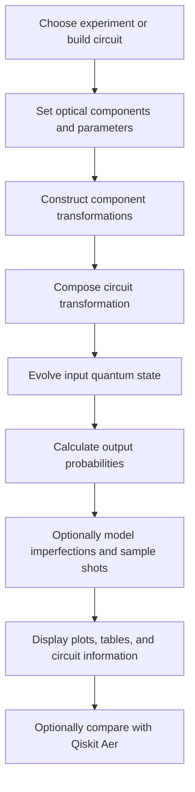
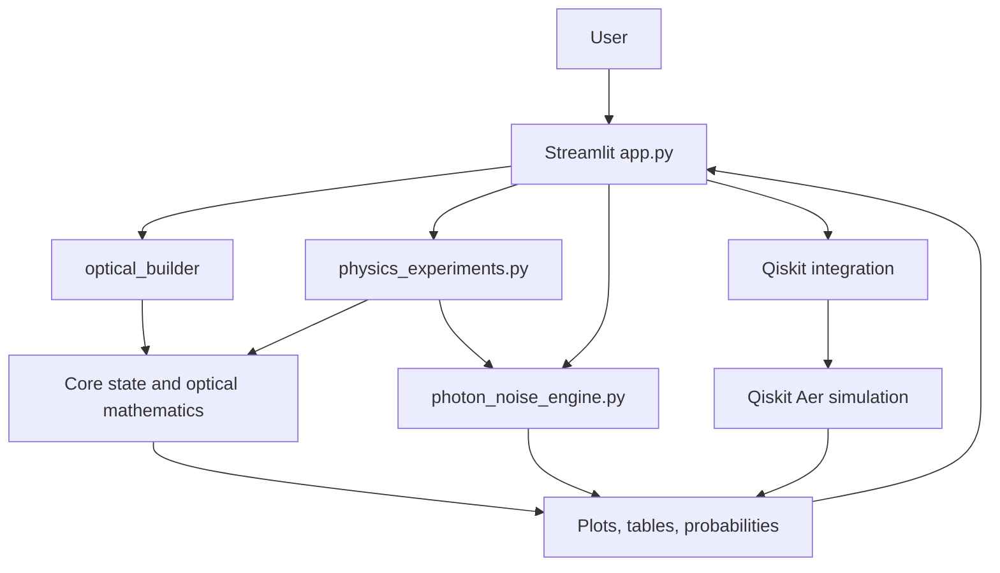

<div align="center">

# ⚛️ QUANTA-SIM

### An Integrated Photonic Quantum Simulator

**Build optical circuits · Explore quantum interference · Model imperfections · Compare with digital quantum simulation**

<p>
  <a href="https://sarkarkinjal0-ai-quanta-sim-app-ottsqz.streamlit.app/"><strong>🚀 Launch Live App</strong></a>
  &nbsp;•&nbsp;
  <a href="https://github.com/sarkarkinjal0-ai/QUANTA-SIM"><strong>💻 Source Code</strong></a>
</p>


*An interactive environment for learning how optical components transform quantum states—and how noise, finite sampling, and modeling conventions affect the results.*

</div>

---

## ✨ At a glance

QUANTA-SIM is an educational Streamlit application for constructing small optical circuits, simulating single- and two-photon behavior, exploring selected imperfections, and comparing optical probabilities with a Qiskit Aer benchmark.

It connects three views of a quantum experiment:

1. **Physics:** optical modes, beam splitters, phase shifters, interference, and photon-counting probabilities.
2. **Computation:** state vectors, matrix operations, unitary evolution, probability distributions, and finite-shot sampling.
3. **Validation:** compare selected optical results with a digital quantum-circuit simulation, while accounting for conventions and sampling uncertainty.

> **Scope:** QUANTA-SIM is a small-system educational simulator. It is not a substitute for laboratory measurements, a fault-tolerant quantum computer, or a validated model of every real photonic device.

## 🧭 Contents

- [Project goals](#-project-goals)
- [Features](#-features)
- [Animations Lab](#-animations-lab)
- [Explore the application](#-explore-the-application)
- [Physics and mathematics](#-physics-and-mathematics)
- [How a simulation runs](#-how-a-simulation-runs)
- [Architecture](#-architecture)
- [Repository map](#-repository-map)
- [Getting started on Windows](#-getting-started-on-windows)
- [Run QUANTA-SIM](#-run-quanta-sim)
- [Beginner tutorials](#-beginner-tutorials)
- [Testing and verification](#-testing-and-verification)
- [Interpreting results](#-interpreting-results)
- [Scientific assumptions and limitations](#-scientific-assumptions-and-limitations)
- [Troubleshooting](#-troubleshooting)
- [Team contributions and provenance](#-team-contributions-and-provenance)
- [Contributing](#-contributing)
- [Roadmap](#-roadmap)
- [Glossary](#-glossary)
- [References and further learning](#-references-and-further-learning)
- [License](#-license)

---

## 🎯 Project goals

QUANTA-SIM is designed to make the relationship between optical hardware concepts and quantum computation easier to explore.

- **Make abstract ideas visible:** connect circuit components with state transformations and output probabilities.
- **Support experimentation:** vary selected optical parameters and compare the resulting behavior.
- **Introduce imperfections:** explore how phase drift, reflectivity errors, and finite shot counts can affect a simulation.
- **Connect optical and digital models:** compare selected optical probability distributions against a Qiskit Aer benchmark.
- **Encourage reproducible learning:** provide a runnable application, integration checks, and a documented workflow.

### Intended audience

| Audience | What they can learn or do |
|---|---|
| Beginners | Learn what modes, beam splitters, phase shifters, and probabilities mean. |
| Physics students | Explore interference, unitary evolution, and two-photon behavior. |
| Computer science students | Follow modular Python code, numerical linear algebra, simulation pipelines, and testing. |
| Quantum-computing learners | Compare a photonic description with a digital circuit model for selected experiments. |
| Project reviewers | Inspect the application structure, run instructions, test entry points, and stated limitations. |

## 🚀 Features

### 1. Circuit Builder

- Construct small optical circuits using **2–4 modes**.
- Work with beam splitters and phase shifters.
- Start from a Mach–Zehnder interferometer (MZI) preset.
- Inspect a circuit schematic.
- Inspect the total unitary transformation and its heatmap.
- Explore single-photon and Fock-state output controls.

### 2. Experiments & Noise

- Sweep MZI parameters to explore interference.
- Adjust phase and reflectivity settings.
- Explore the effects of selected noise and component imperfections.
- Inspect interference visibility.
- Explore Hong–Ou–Mandel (HOM) probabilities and finite-shot counts.

### 3. Qiskit Comparison

- Run the optical-to-digital benchmark implemented by the Qiskit integration.
- Inspect optical and digital probability results.
- Review Total Variation Distance (TVD), classical fidelity, and Hellinger distance.
- Inspect the generated digital circuit and gate/resource breakdown.
- Remember that finite-shot estimates fluctuate statistically.

### 4. ABOUT

- Review the project's purpose, concepts, mathematical background, and software architecture.
- Access the integration smoke-test control if available in the current app version.

### 5. Animations Lab

Explore visual, step-by-step representations of key quantum-photonics concepts. The Animations Lab is designed to make component behavior and interference easier to follow alongside the numerical results.

- **Beam splitter animation:** visualize how optical modes mix at a beam splitter.
- **Phase shifter animation:** explore how changing a phase affects a mode's complex amplitude and later interference.
- **Mach–Zehnder interferometer (MZI):** follow the two-path circuit and observe how relative phase changes the output behavior.
- **Hong–Ou–Mandel (HOM) interference:** visualize the two-photon interference concept and its output behavior.
- **Qiskit circuit visualization:** inspect a digital quantum-circuit representation alongside the project's optical simulation workflow.

Animations are explanatory visualizations of the implemented model; they are not live laboratory measurements. Exact controls and visual details may vary with the deployed version.

### 6. Tutorial

- Use the in-app learning material to navigate the simulator and follow the experiment workflow.
- Pair the tutorials below with the live application for a guided first session.

---

## 🖥️ Explore the application

**Live app:** [QUANTA-SIM on Streamlit Community Cloud](https://sarkarkinjal0-ai-quanta-sim-app-ottsqz.streamlit.app/)

The current interface is organized into six tabs:

| Tab | Main question | What to inspect |
|---|---|---|
| **Circuit Builder** | What transformation does this optical circuit implement? | Circuit schematic, unitary matrix, heatmap, output state. |
| **Experiments & Noise** | How do phase, reflectivity, and imperfections affect interference? | MZI sweep, HOM results, visibility, sampled counts. |
| **Qiskit Comparison** | How closely do the selected optical and digital models agree? | Probability distributions and comparison metrics. |
| **Animations Lab** | How can quantum-photonics behavior be explored visually? | Beam splitter, phase shifter, MZI, HOM, and Qiskit-circuit animations. |
| **ABOUT** | What concepts and modules make up the project? | Mathematical explanations, architecture, validation controls. |
| **Tutorial** | How should a new user explore the app? | Guided workflow and usage tips. |

> The live deployment may be updated independently of this document. If the interface differs, use the labels and controls shown in the deployed app.

---

## 🎞️ Animations Lab

The **Animations Lab** adds a visual learning path to QUANTA-SIM. Use it to build intuition about optical components and interference before or after running the numerical experiments.

| Animation | What to look for | Suggested exploration |
|---|---|---|
| **Beam splitter** | How an optical component mixes modes. | Watch the input/output representation and relate it to the component transformation. |
| **Phase shifter** | How a phase parameter changes a mode's phase. | Change the phase, then consider why the effect becomes observable when paths interfere. |
| **Mach–Zehnder interferometer (MZI)** | How two paths are split and recombined. | Vary the relative phase and compare the visual behavior with the MZI probability sweep. |
| **Hong–Ou–Mandel (HOM) interference** | How two-photon amplitudes can produce correlated output behavior. | Relate the animation to the coincidence probabilities in Experiments & Noise. |
| **Qiskit circuits** | How a digital circuit is represented for the comparison workflow. | Compare the circuit view with the optical experiment it is intended to model. |

### Suggested workflow

1. Open **Animations Lab** and choose a visualization.
2. Observe the default behavior before changing parameters.
3. Change one available control at a time and note what changes.
4. Open **Circuit Builder** or **Experiments & Noise** to inspect the corresponding numerical model.
5. If relevant, use **Qiskit Comparison** to inspect the digital benchmark and its comparison metrics.

**Interpretation note:** animations help explain the model; they do not independently validate the physics, prove equivalence between models, or represent measurements from physical hardware.

---

## 🔬 Physics and mathematics

This section introduces the central mathematical ideas behind the simulator. Exact component conventions must be taken from the relevant implementation; the equations below describe the general framework and the convention noted for the MZI Qiskit benchmark.

### 1. Optical modes and quantum states

An optical **mode** describes a field channel distinguished by properties such as its spatial path. In a small interferometer, modes are often represented as paths through which photons can propagate.

For a single photon distributed across \(m\) modes, a pure state can be written as

\[
|\psi\rangle = \sum_{j=0}^{m-1} c_j |j\rangle,
\qquad
\sum_{j=0}^{m-1}|c_j|^2=1.
\]

Here:

- \(|j\rangle\) means the photon occupies mode \(j\).
- \(c_j\) is a complex probability amplitude.
- \(|c_j|^2\) is the probability of detecting the photon in mode \(j\), when the \(|j\rangle\) basis corresponds to the measured outcomes.

Amplitudes are complex numbers. Their phases matter because amplitudes can interfere before probabilities are calculated.

### 2. Quantum evolution and unitary matrices

An ideal lossless optical circuit is represented by a unitary transformation \(U\):

\[
|\psi_{\mathrm{out}}\rangle=U|\psi_{\mathrm{in}}\rangle,
\qquad U^\dagger U=I.
\]

- \(U\) is the circuit's transformation matrix.
- \(U^\dagger\) is its conjugate transpose.
- \(I\) is the identity matrix.

The unitarity condition expresses norm preservation for the ideal model. If a circuit is assembled from components with matrices \(U_1,U_2,\ldots,U_k\), the total matrix is the ordered product of the component matrices. The order depends on the convention used to represent state vectors and circuit composition.

**Implementation note:** Use the matrices and multiplication order in the code as the source of truth for QUANTA-SIM's actual component convention.

### 3. Beam splitters

A beam splitter mixes optical modes. A photon entering one input can emerge in a superposition of output modes.

For a lossless two-port beam splitter, the reflectivity \(R\) and transmissivity \(T\) satisfy

\[
R+T=1.
\]

A common parameterization of a beam-splitter matrix uses amplitudes related to \(\sqrt{R}\) and \(\sqrt{T}\), with phase factors that depend on the chosen convention. Different conventions can describe equivalent physical devices while producing different-looking matrix entries.

QUANTA-SIM's Qiskit bridge uses the **imaginary-symmetric beam-splitter convention** for the MZI benchmark. Comparisons should use matching conventions on both sides.

### 4. Phase shifters

A phase shifter changes the relative phase of an optical mode. In a simple single-mode representation, its transformation has the form

\[
U_{\phi}=
\begin{pmatrix}
e^{i\phi} & 0\\
0 & 1
\end{pmatrix},
\]

when the phase is applied to the first of two modes. Applying the phase to a different mode changes the corresponding diagonal entry.

A phase shift may not change an individual mode's intensity in isolation, but it can change interference when paths are recombined.

### 5. The Mach–Zehnder interferometer (MZI)

An MZI typically consists of two beam splitters separated by two paths, with a controllable relative phase between the paths.

Conceptually:

```text
Input
  │
  ▼
[Beam splitter 1]
  ├────────────── Path A ──────────────┐
  │                                    │
  └────────────── Path B ──[Phase φ]───┤
                                       ▼
                                [Beam splitter 2]
                                  │          │
                                  ▼          ▼
                               Output 1   Output 2
```

The first beam splitter creates path amplitudes. A phase shift changes their relative phase. The second beam splitter recombines them, causing constructive or destructive interference at the outputs.

The output probabilities depend on the complete transformation, including component parameters and phase conventions. Use the MZI sweep in **Experiments & Noise** to explore this dependence rather than assuming a formula for a different beam-splitter convention.

### 6. Born rule: amplitudes become probabilities

If the output state is

\[
|\psi\rangle=\sum_j c_j|j\rangle,
\]

then measurement in that basis gives

\[
P(j)=|\langle j|\psi\rangle|^2=|c_j|^2.
\]

The probabilities should sum to one for a normalized state and a complete measurement basis. This is a useful sanity check when inspecting simulation outputs.

### 7. Fock states and two-photon behavior

A Fock state describes a definite photon number in each mode. For example, \(|1,1\rangle\) represents one photon in each of two modes.

Two-photon behavior cannot always be understood as two independent classical particles following separate paths. Probability amplitudes for indistinguishable alternatives can combine, producing correlations in the measured output counts.

The simulator includes two-photon/Fock-state behavior and HOM analysis in its documented features. Exact state-space truncation and supported input configurations depend on the implemented engine.

### 8. Hong–Ou–Mandel (HOM) interference

In a standard HOM experiment, indistinguishable photons enter opposite input ports of a beam splitter. Under the appropriate conditions, the two photons tend to leave together through the same output port rather than separately. This produces a reduction—or dip—in coincidence detections.

The result depends on assumptions such as photon indistinguishability, temporal overlap, beam-splitter parameters, and the measurement definition. Real experiments can deviate because of loss, distinguishability, detector effects, and other imperfections.

Use the HOM controls to inspect the simulated coincidence behavior and visibility. Treat it as a model result, not as evidence of a physical laboratory measurement.

### 9. Noise and finite-shot sampling

A simulator can calculate ideal probabilities and then sample a finite number of measurement outcomes. If an outcome has probability \(p\) and there are \(N\) independent shots, the expected count is

\[
\mathbb{E}[n]=Np.
\]

For a binomial estimate \(\hat p=n/N\), the standard deviation under independent sampling is

\[
\sigma_{\hat p}=\sqrt{\frac{p(1-p)}{N}}.
\]

More shots generally reduce sampling uncertainty, with a typical \(1/\sqrt{N}\) scaling. They do not remove systematic model errors or physical imperfections.

QUANTA-SIM exposes selected phase and reflectivity imperfections, as well as finite-shot sampling. The precise stochastic model and its parameter meanings are implementation-specific.

---

## 📐 How a simulation runs

At a high level, a simulation follows this pipeline:



### The computer science behind it

- **Numerical linear algebra:** complex-valued vectors and matrices represent states and component transformations.
- **Composition:** component matrices are combined in the order defined by the circuit model.
- **Probability calculation:** amplitudes are converted to probabilities using squared magnitudes.
- **Sampling:** finite-shot outcomes are generated from a probability distribution.
- **Modular design:** physics, optical building, experiments, noise modeling, digital benchmarking, and UI code are separated into modules.
- **Visualization:** plots, schematics, heatmaps, and tables expose intermediate and final results.
- **Testing:** integration tests check selected connections between software components.

---

## 🏗️ Architecture

The application is a Streamlit-based Python project. The UI connects reusable simulation and experiment modules; the Qiskit integration provides a digital comparison path for selected benchmarks.



This is a **conceptual dependency view**, not a complete import graph. Confirm individual imports and call paths in the source code when making architectural changes.

### Main responsibilities

| Module or path | Role described by the project |
|---|---|
| `app.py` | Streamlit entry point; integrates the UI tabs and calls into the modules. |
| `quantum_animations.py` | Animations Lab visualizations for selected optical components, MZI/HOM behavior, and Qiskit circuits. |
| `core_engine.py` | Quantum state vectors, unitary evolution, beam-splitter/phase-shifter mathematics, and Born-rule probabilities. |
| `optical_builder/` | Optical circuit builder, schematic, component controls, unitary display, and simulation controls. |
| `physics_experiments.py` | Orchestrates MZI sweeps and HOM analyses. |
| `photon_noise_engine.py` | Photon evolution, two-photon/Fock-state outputs, phase/reflectivity imperfections, and finite-shot sampling. |
| `qiskitintegration/` | Optical-to-circuit conversion, circuit construction, Aer simulation, benchmarks, and plots. |
| `test_integration.py` | Integration smoke test entry point. |
| `tests/` | Additional tests retained with the original project, if compatible with the installed environment. |
| `core/`, `experiments/`, `optics/`, `quantum/`, `visualization/` | Directories retained from the original project. |
| `app_original.py` | Preserved original dashboard entry point, according to the project assembly notes. |
| `team_submissions/` | Retained source archives for traceability; not imported by the application. |
| `requirements.txt` | Python dependencies used for local setup and deployment. |
| `ORIGINAL_PROJECT_PRESERVATION.md` | Notes about preserving the original project, if present in the repository. |

> **Repository accuracy:** This map follows the project information currently documented by the maintainers. If a path has been renamed or is absent in a particular checkout, verify it in the repository before relying on the entry or modifying it.

### Why separate modules?

Separating the UI from the simulation logic helps make the project easier to test and extend. For example, a mathematical correction to a state transformation should ideally be testable without requiring a user to click through the Streamlit interface. Similarly, the Qiskit benchmark should be understandable as a comparison pipeline rather than mixed into every optical component.

---

## 💻 Getting started on Windows

### Prerequisites

Install:

- **Python 3** compatible with the project's pinned dependencies.
- **Git** if you want to clone or contribute to the repository.
- **Visual Studio Code** or another editor (optional but useful).
- A terminal such as PowerShell or Command Prompt.

Repository: [sarkarkinjal0-ai/QUANTA-SIM](https://github.com/sarkarkinjal0-ai/QUANTA-SIM)

### 1. Clone the repository

Open PowerShell and run:

```powershell
git clone https://github.com/sarkarkinjal0-ai/QUANTA-SIM.git
cd QUANTA-SIM
```

If you already have a local project folder, open that folder and skip cloning.

### 2. Create a virtual environment

```powershell
py -m venv .venv
```

A virtual environment keeps this project's packages separate from other Python projects on your computer.

### 3. Activate it

```powershell
.\.venv\Scripts\Activate.ps1
```

If PowerShell blocks activation, you can use the environment's Python executable directly in the commands below. Avoid changing machine-wide security settings just to activate an environment.

### 4. Upgrade pip and install dependencies

```powershell
python -m pip install --upgrade pip
python -m pip install -r requirements.txt
```

If `python` is not recognized, try `py` or use:

```powershell
.\.venv\Scripts\python.exe -m pip install -r requirements.txt
```

### 5. Check dependency consistency

```powershell
python -m pip check
```

A healthy environment should report:

```text
No broken requirements found.
```

### macOS/Linux note

The equivalent environment commands are typically:

```bash
python3 -m venv .venv
source .venv/bin/activate
python -m pip install --upgrade pip
python -m pip install -r requirements.txt
```

---

## ▶️ Run QUANTA-SIM

From the repository root, with the virtual environment active:

```powershell
streamlit run app.py
```

Streamlit will print a local URL—commonly `http://localhost:8501`—that you can open in a browser.

To launch the preserved original dashboard, if that file exists in your checkout:

```powershell
streamlit run app_original.py
```

Use `Ctrl+C` in the terminal to stop the local server.

---

## 🧑‍🎓 Beginner tutorials

These exercises are designed to be performed in the app. Record your parameter settings and observations if you want to compare runs later.

### Tutorial 1 — Get familiar with the interface

1. Open the [live app](https://sarkarkinjal0-ai-quanta-sim-app-ottsqz.streamlit.app/).
2. Visit the six tabs: **Circuit Builder**, **Experiments & Noise**, **Qiskit Comparison**, **Animations Lab**, **ABOUT**, and **Tutorial**.
3. Identify which tab builds circuits, which runs experiments, and which performs digital comparisons.
4. Start with the default settings before changing any parameters.

**Learning goal:** Understand the role of each part of the application.

### Tutorial 2 — Build a simple optical circuit

1. Open **Circuit Builder**.
2. Select the supported number of modes and add or inspect the available optical components.
3. If a preset such as MZI is available, load it.
4. Inspect the circuit schematic and total unitary matrix.
5. Inspect the unitary heatmap and the output-state or probability display.
6. Change one component parameter and observe what changes.

**Questions to consider:**
- Does the circuit schematic reflect your selected components?
- Does changing a phase or reflectivity parameter change the transformation?
- Do output probabilities remain normalized where the model expects a complete, lossless measurement?

### Tutorial 3 — Explore MZI interference

1. Open **Experiments & Noise**.
2. Locate the MZI controls and sweep or adjust the phase.
3. Observe the output-probability curves.
4. Change reflectivity and compare the curve with the previous run.
5. Record the settings for two contrasting cases.

**Learning goal:** See how relative phase and beam-splitter parameters affect recombination.

**Do not assume:** A familiar textbook MZI formula will match every convention. Compare the observed results with the implementation's beam-splitter matrices and phase placement.

### Tutorial 4 — Explore HOM behavior

1. In **Experiments & Noise**, locate the HOM experiment.
2. Run the default configuration.
3. Inspect coincidence probabilities, visibility, or the available output table.
4. If the interface exposes relevant parameters, change one at a time.
5. Note which assumptions are fixed by the model.

**Learning goal:** Understand why indistinguishable two-photon amplitudes can produce behavior that differs from a simple independent-particle picture.

### Tutorial 5 — Turn noise on and off

1. Record an ideal or noise-disabled result.
2. Enable the available noise option.
3. Change one noise parameter, such as phase drift or reflectivity error.
4. Compare the output probabilities, visibility, or sampled counts.
5. Repeat with another setting.

**Learning goal:** Distinguish ideal-model behavior from behavior under the selected simulated imperfections.

A noise toggle only represents the effects explicitly implemented by the model. It does not automatically account for every real-world source of loss or error.

### Tutorial 6 — Understand finite-shot sampling

1. Find the shot-count control in the relevant experiment.
2. Record a result at a lower shot count.
3. Increase the number of shots and run again.
4. Compare the sampled counts or estimated probabilities.

**Learning goal:** Understand that measured counts are random samples from a probability distribution. Increasing shots generally reduces statistical variation but does not fix a wrong model.

### Tutorial 7 — Compare with Qiskit Aer

1. Open **Qiskit Comparison**.
2. Set the benchmark parameters and shot count.
3. Run the benchmark.
4. Inspect the optical and digital probabilities.
5. Review TVD, classical fidelity, and Hellinger distance.
6. Inspect the circuit diagram and gate/resource breakdown if displayed.
7. Repeat with a different shot count and compare.

**Learning goal:** Learn how two simulation representations can be compared quantitatively.

**Important:** A mismatch may result from different basis orderings, phase conventions, transformations, measurement mappings, or finite-shot fluctuations. A single metric does not prove the models are physically equivalent.

### Tutorial 8 — Explore the Animations Lab

1. Open **Animations Lab**.
2. Explore the beam splitter and phase shifter visualizations.
3. Watch the MZI animation and vary the relative phase if a control is available.
4. Explore the HOM animation and relate it to the coincidence behavior discussed in the HOM experiment.
5. Inspect the Qiskit-circuit visualization and compare its role with the optical workflow.
6. Open **Experiments & Noise** or **Qiskit Comparison** to connect the visual explanation with numerical outputs.

**Learning goal:** Build intuition for the optical and digital representations, then use the simulation results to investigate them quantitatively.

### Tutorial 9 — Build a small, reproducible study

Choose one question, for example: *How does a phase change affect the MZI output probabilities?*

1. State the question and expected qualitative behavior.
2. Choose one independent parameter to vary.
3. Keep the other parameters fixed.
4. Record the initial settings.
5. Run several parameter values.
6. Save the observed values or screenshots for your report.
7. Explain any discrepancy between expectation and simulation.

A useful experiment record includes:

| Item | What to record |
|---|---|
| Research question | The effect you want to investigate |
| Model | MZI, HOM, or a constructed circuit |
| Parameters | Phase, reflectivity, noise settings, shots |
| Output | Probabilities, counts, visibility, metrics |
| Observation | What changed and in which direction |
| Limitations | Assumptions, conventions, sampling variation |

---

## 🧪 Testing and verification

Run tests from the project root with the intended virtual environment activated.

### Integration smoke test

```powershell
python test_integration.py
```

This is the documented integration-test entry point. It should complete without an unhandled exception and report its test results.

A previously observed successful output in the development workflow was:

```text
All integration tests passed.
Optical Builder integration test passed.
```

That is a record of a reported run, not a guarantee that every future checkout or environment will produce the same result.

### Pytest suite

```powershell
python -m pytest -q
```

This runs tests discoverable by pytest. A successful run should end with a pass summary and no failed tests. If pytest is not installed in the active environment, install the project's declared development/test dependencies or follow the repository's test setup.

### Dependency check

```powershell
python -m pip check
```

This checks installed package requirements for conflicts; it does not test scientific correctness.

### Manual UI regression checklist

- [ ] App starts using `streamlit run app.py`.
- [ ] All six tabs render.
- [ ] Animations Lab loads the beam splitter, phase shifter, MZI, HOM, and Qiskit-circuit visualizations available in the deployed version.
- [ ] Circuit Builder displays the expected controls and outputs.
- [ ] MZI experiment runs and produces plots or results.
- [ ] HOM experiment runs and displays its outputs.
- [ ] Noise controls affect the simulated results as intended.
- [ ] Qiskit benchmark runs in an environment with the required Qiskit packages.
- [ ] Metrics, probability tables, and circuit information render without errors.
- [ ] ABOUT and Tutorial content is readable.
- [ ] The live deployment corresponds to the intended Git commit.

### What each check establishes

| Check | What it can help establish | What it does not establish by itself |
|---|---|---|
| Integration test | Selected modules work together for tested cases. | Every physical model is correct. |
| Pytest | Discovered automated tests pass. | Untested code paths are bug-free. |
| `pip check` | Installed package requirements are consistent. | The application UI works. |
| Manual UI test | The exercised interface paths work in that environment. | All parameter combinations are valid. |
| Qiskit comparison | Selected optical and digital outputs can be compared. | Universal equivalence of the two models. |

---

## 📊 Interpreting results

### Probability distributions

For a complete, normalized measurement distribution, probabilities should be non-negative and sum to approximately one, allowing for numerical precision. If finite-shot counts are displayed, divide each count by the total number of shots to obtain empirical frequencies.

### Total Variation Distance (TVD)

For two discrete probability distributions \(P\) and \(Q\),

\[
D_{\mathrm{TV}}(P,Q)=\frac{1}{2}\sum_i |P_i-Q_i|.
\]

TVD is zero when the distributions are identical and increases as they differ. For normalized discrete distributions, it lies between zero and one.

### Classical fidelity

One common classical fidelity convention for probability distributions is

\[
F(P,Q)=\left(\sum_i \sqrt{P_iQ_i}\right)^2.
\]

Under this convention, identical distributions have fidelity one. Some libraries use the unsquared Bhattacharyya coefficient instead; check the implementation before interpreting a displayed value.

### Hellinger distance

One common convention is

\[
H(P,Q)=\frac{1}{\sqrt{2}}
\sqrt{\sum_i\left(\sqrt{P_i}-\sqrt{Q_i}\right)^2}.
\]

Under this convention, identical distributions have distance zero. Different normalizations exist, so verify the formula implemented in the Qiskit bridge when reporting numeric results.

### Reading a comparison responsibly

Before interpreting a metric, confirm:

1. Both distributions refer to the same physical outcomes.
2. Basis states and mode labels have been mapped consistently.
3. Both models use the same relevant physical transformation and phase convention.
4. The number of shots and any stochastic settings are recorded.
5. The metric's exact formula and normalization are known.

A nonzero difference can be expected with finite-shot sampling. It may also expose a convention mismatch or a modeling bug, so investigate rather than assuming either explanation.

---

## ⚠️ Scientific assumptions and limitations

QUANTA-SIM is an educational numerical model. Keep these limitations in mind when using or presenting its results:

- **Small-system focus:** the documented builder is intended for small circuits with 2–4 modes. Computational cost and supported state spaces depend on the specific simulation engine.
- **Model versus experiment:** simulated results are not laboratory measurements.
- **Ideal transformations:** unitarity describes ideal lossless evolution. Real components may include loss and other non-unitary effects that are not necessarily modeled.
- **Selected noise only:** the application exposes particular imperfections, not every source of optical noise.
- **Convention sensitivity:** beam-splitter phases, mode ordering, tensor-product conventions, and basis mapping affect the representation of a circuit.
- **Finite shots:** sampled outcomes fluctuate. More shots reduce sampling uncertainty but do not eliminate systematic errors.
- **Qiskit scope:** the benchmark validates only the cases and mappings implemented by the bridge, not arbitrary photonic circuits.
- **Testing scope:** passing automated integration tests indicates that the tested paths passed; it does not prove all physics, numerical methods, or parameter combinations are correct.
- **Reproducibility:** random sampling can vary between runs unless random seeds and the relevant code paths support controlled reproducibility.

For research-grade claims, document the exact parameters, equations, conventions, software versions, and test cases. Validate the model against trusted analytical results or independent implementations.

---

## 🛠️ Troubleshooting

### `python` is not recognized

Try:

```powershell
py --version
py -m pip --version
```

If Python is not installed, install a compatible Python 3 release and reopen the terminal. On Windows, the Python launcher `py` may work when `python` does not.

### `ModuleNotFoundError`

1. Confirm the terminal is in the repository root.
2. Activate the project's virtual environment.
3. Install the declared dependencies:

```powershell
python -m pip install -r requirements.txt
```

4. Confirm the selected interpreter is the environment you intended to use.

### Streamlit command is not found

Use the module form:

```powershell
python -m streamlit run app.py
```

If Streamlit is not installed in that environment, install the declared project requirements first.

### Qiskit benchmark fails

- Confirm the Qiskit and Aer dependencies required by the project are installed.
- Read the complete traceback.
- Check that the local Python environment matches the project's requirements.
- Verify that the failing benchmark configuration is supported by the current bridge.

Do not silently interpret a failed benchmark as a physics mismatch; first establish whether the digital simulation actually ran.

### Tests pass locally but the deployed app fails

- Read the Streamlit deployment logs.
- Confirm the deployed repository, branch, and main-file path.
- Check that dependencies are declared in the root `requirements.txt`.
- Verify that the deployed commit includes the latest changes.
- Avoid relying on packages installed only on your local machine.

### Plots or probabilities look unexpected

- Start from the default settings.
- Change one parameter at a time.
- Check normalization and mode ordering.
- Confirm the phase and beam-splitter conventions.
- Increase shots to investigate sampling variation.
- Compare with a simple analytical or independently tested case.

---

## 👥 Team contributions and provenance

The integrated project documentation attributes the following responsibilities:

| Contribution | Associated module or path | Documented responsibility |
|---|---|---|
| Member 1 — Core Physics & Mathematics | `core_engine.py` | State vectors, unitary evolution, beam-splitter/phase-shifter mathematics, Born-rule probabilities. |
| Member 2 — Optical Components & Optical Builder | `optical_builder/` | Circuit builder, schematic, component controls, unitary display, and simulation controls. |
| Member 3 — Interferometry & Experiments | `physics_experiments.py` | MZI sweeps and HOM analysis orchestration. |
| Member 4 — Photon & Noise Engine | `photon_noise_engine.py` | Photon evolution, two-photon/Fock-state outputs, selected imperfections, finite-shot sampling. |
| Member 5 — Qiskit Integration | `qiskitintegration/` | Optical-to-circuit conversion, Aer simulation, benchmarks, and plots. |
| Member 6 — UI, Visualization & Integration | `app.py`, `quantum_animations.py` | Streamlit UI, integrated application tabs, and Animations Lab visualizations. |

These are project responsibility descriptions, not independent verification of authorship or scientific correctness.

The assembly notes state that original ZIPs for Members 1, 3, 4, and 5 are preserved under `team_submissions/` for traceability and are not imported by the application. They also state that Member 2's separate original source archive was not included in the supplied deliverables; the integrated `optical_builder/` package was included in Member 4's integrated submission. If the original archive becomes available, compare it with the integrated package before replacing files.

The original dashboard is documented as preserved in `app_original.py`. Consult `ORIGINAL_PROJECT_PRESERVATION.md` if it is present in your checkout.

---

## 🤝 Contributing

Contributions that improve correctness, reproducibility, accessibility, or documentation are welcome.

Suggested workflow:

1. Create a branch for your change.
2. Make one focused change at a time.
3. Add or update tests for behavior changes.
4. Run the integration test and relevant pytest tests.
5. Test the affected UI path locally.
6. Document new assumptions, parameter meanings, and scientific conventions.
7. Open a pull request or submit the change for review.

### Good contributions

- Unit tests for optical component matrices and unitarity.
- Analytical reference cases for MZI and HOM experiments.
- Explicit documentation of mode ordering and phase conventions.
- Reproducible sampling controls and random-seed support.
- Clear error messages for unsupported parameter combinations.
- Accessible plots, labels, and beginner explanations.
- More systematic comparison tests for the optical-to-Qiskit bridge.

Please avoid claiming a scientific validation that has not been performed.

---

## 🗺️ Roadmap

The following are **possible future improvements**, not claims that they already exist:

- [ ] Add unit tests for individual component matrices and state evolution.
- [ ] Document beam-splitter, mode-ordering, and phase conventions in one canonical reference.
- [ ] Add analytical benchmark cases for selected MZI and HOM configurations.
- [ ] Make stochastic simulations reproducible through explicit seed controls where appropriate.
- [ ] Export experiment parameters and results to CSV.
- [ ] Export circuit configurations for later reuse.
- [ ] Add clearer metadata to plots: parameter values, shot count, and model settings.
- [ ] Expand accessibility and beginner-focused explanations.
- [ ] Extend Animations Lab with additional parameter controls and visualizations where scientifically appropriate.
- [ ] Add automated regression tests for optical-to-Qiskit outcome mapping.
- [ ] Document tested Python and dependency versions for reproducible deployment.

---

## 📚 Glossary

| Term | Meaning |
|---|---|
| **Mode** | An optical field channel, such as a spatial path. |
| **Probability amplitude** | A generally complex number whose squared magnitude gives a measurement probability in the relevant basis. |
| **Unitary matrix** | A matrix \(U\) satisfying \(U^\dagger U=I\), representing norm-preserving evolution in the ideal model. |
| **Beam splitter** | An optical component that mixes input modes. |
| **Phase shifter** | A component that changes the phase of one or more modes. |
| **Interference** | The combination of amplitudes, which can reinforce or cancel depending on relative phase. |
| **MZI** | Mach–Zehnder interferometer, a two-path arrangement that recombines optical amplitudes. |
| **Fock state** | A quantum state with a definite photon number in each mode. |
| **HOM effect** | Two-photon interference associated with suppressed coincidence detections for suitable indistinguishable inputs and beam-splitter conditions. |
| **Shot** | One simulated measurement trial or sample. |
| **Visibility** | A contrast measure for an interference feature; the exact formula depends on the implementation. |
| **Qiskit Aer** | A simulator backend for digital quantum circuits. |
| **TVD** | Total Variation Distance between two discrete probability distributions. |
| **Fidelity** | A similarity measure; the precise convention should be documented. |
| **Hellinger distance** | A distance between probability distributions based on their square-root probabilities. |

---

## 📖 References and further learning

These are general learning resources for the concepts used in the project; they are not evidence that the application has been independently validated.

- [Streamlit documentation](https://docs.streamlit.io/) — building and running interactive Python apps.
- [NumPy documentation](https://numpy.org/doc/) — numerical arrays and linear algebra.
- [Pandas documentation](https://pandas.pydata.org/docs/) — tables and data manipulation.
- [Qiskit documentation](https://docs.quantum.ibm.com/) — quantum-computing concepts and tooling.
- [Qiskit Aer documentation](https://qiskit.github.io/qiskit-aer/) — circuit simulation.
- [QuTiP documentation](https://qutip.org/) — quantum dynamics and quantum optics tools for further study.

For quantum optics, study complex probability amplitudes, matrix representations of optical elements, bosonic creation/annihilation operators, Fock states, and two-photon interference. When using an external source to verify a formula, check that its convention matches the implementation.

---

## 📄 License

**License status: confirm before reuse or redistribution.**

No license identifier was specified in the supplied project description. Before distributing the code for reuse, add a `LICENSE` file and update this section with the actual license and any relevant third-party notices. Do not claim an open-source license until one has been selected and committed.

---

<div align="center">

### Explore the behavior. Inspect the mathematics. Test the model.

**[Launch QUANTA-SIM](https://sarkarkinjal0-ai-quanta-sim-app-ottsqz.streamlit.app/) · [View source on GitHub](https://github.com/sarkarkinjal0-ai/QUANTA-SIM)**

*QUANTA-SIM is an educational simulation project. Interpret numerical outputs in the context of the model assumptions, conventions, and tests described above.*

</div>
